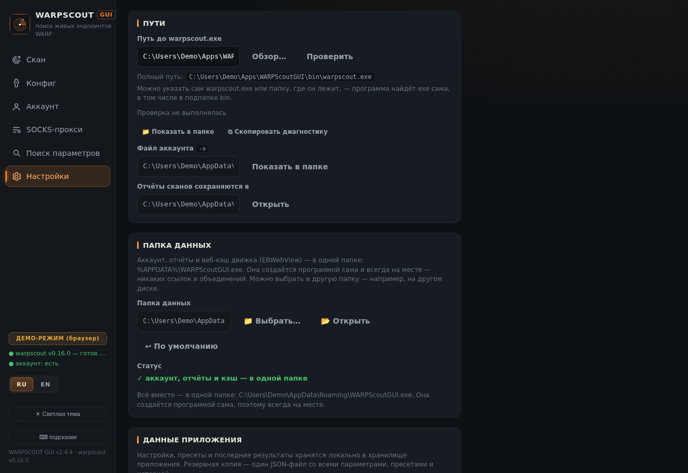
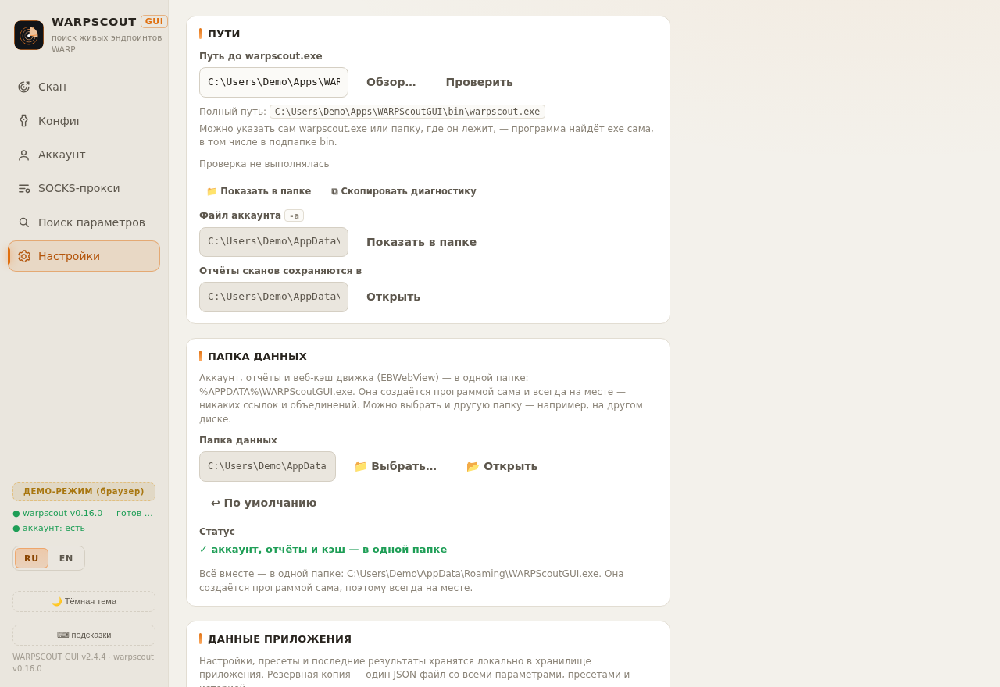

# WARPScoutGUI-AWG

English | [Русский](README.md)

A graphical shell for [**warpscout**](https://github.com/vernette/warpscout) — a CLI scanner of WARP endpoints by [vernette](https://github.com/vernette) (Go, MIT). The **-AWG** suffix sets this GUI apart from other wrappers: the project works with configurations in the **AmneziaWG** format (awg31).

A desktop and mobile application (Neutralino.js / WebView) around the `warpscout` CLI utility: WARP account registration, generation of `.conf` files in the AmneziaWG format, config import/validation, QR codes, a scanner of live WARP endpoints.

## Interface

| Dark theme | Light theme |
|---|---|
|  |  |

▶ **Web demo of the interface** (on mocks, without Neutralino) — [**rvmxl.github.io/WarpScoutGUI-AWG**](https://rvmxl.github.io/WarpScoutGUI-AWG/) — you can click around the interface right in the browser without downloading anything. On a mobile screen the demo switches to touch mode, just like the Android version.

## Download

Ready-made builds are in the **[Releases](https://github.com/RVMXL/WarpScoutGUI-AWG/releases)** section.

Current version: **v2.8.4** — [releases/tag/v2.8.4](https://github.com/RVMXL/WarpScoutGUI-AWG/releases/tag/v2.8.4), a single release for the six target platforms, built and published by CI on a tag push. This is a full release: the 2.8.0–2.8.3 series was published as pre-releases (manual verification), has been verified and is closed — the "⬆ WarpScoutGUI" banner in the app will offer v2.8.4 to users of 2.7.3/2.8.0/2.8.1/2.8.2/2.8.3.

Key properties of the current build:

- **Android — minimum privileges**: the app's only permission is `INTERNET`. Data lives in the app's private directory; what actually gets copied out, to the shared `Download/WARPScoutGUI` folder via MediaStore, is the scan report, the account and finished configs (more below).
- **Desktop — portable, no installation**: the unpacked archive is self-sufficient; `chmod +x` is granted natively via `fs.setPermissions` (Linux/macOS), commands are assembled through unified escaping points (`psQuote`/`cmdWinPath`).
- **Modular architecture**: the interface logic is 15 modules in `resources/js/wsg/` (01-platform … 15-init), included by `index.html` strictly by number.
- **The `warpscout` core v0.17.0** in all packages; the GUI does not change scanner behavior.
- **Engineering scaffolding**: CI (GitHub Actions: static checks on every push + a full release pipeline on a tag), 168 unit tests of pure functions (node --test, zero dependencies), SBOM-lite (`tools/deps.json` + `verify-deps.py`), provenance of the vendored qrcode.js (js1.5.2), a single version source (`tools/gen-version.py`), a deterministic build of `resources.neu`, binaries distributed via Releases (`tools/fetch-binaries.py`).

Version-by-version change history — in [`CHANGELOG.md`](CHANGELOG.en.md) and the release notes.

**Release policy:** every release contains artifacts for **all** supported platforms under a single version number — including platforms whose code did not change in this release; the release notes state, for each platform, what changed or explicitly record that nothing changed. Publishing is automated (since v2.6.5, audit INFRA-H): a push of a `v*` tag runs the `release` workflow, which passes a gate of checks (version = tag, unit tests, i18n, SHA pins of the binaries), builds all 6 artifacts — including the APK with a signing key from an encrypted repository secret (SHA check against substitution) — and publishes the release with notes and a SHA table, then updates the web demo on gh-pages. The former manual publisher `scripts/release.sh` is kept as an alternative: before creating a release it waits for a green "ci" run on the tag commit and fails if the check is red; the script's pre-flight checks (version consistency, a CHANGELOG section, release notes, the presence of all 6 artifacts) are fail-fast, with a soft mode only via explicit `WS_FORCE=1` (audit INFRA-G). Re-running an existing tag — Actions → release → Run workflow (enter the tag).

| Artifact | Platform | Size |
|---|---|---|
| `WARPScoutGUI-2.8.4-win64` | Windows 10/11 (x86_64) | 6.4 MB |
| `WARPScoutGUI-2.8.4-linux64` | Linux (x86_64) | 5.0 MB |
| `WARPScoutGUI-2.8.4-linux-arm64` | Linux (ARM64 / aarch64) | 4.4 MB |
| `WARPScoutGUI-2.8.4-mac-arm64` | macOS Apple Silicon (M1–M4) | 5.8 MB |
| `WARPScoutGUI-2.8.4-mac-x64` | macOS Intel | 6.2 MB |
| `WARPScoutGUI-2.8.4-android-arm64.apk` | Android 7.0+ (ARM64) | 5.1 MB |

SHA-256 checksums of all artifacts are in the [release notes](https://github.com/RVMXL/WarpScoutGUI-AWG/releases/tag/v2.8.4) and in the [Integrity check](#integrity-check) section below.

**Contents of the desktop archive** (identical on all platforms, 9 entries):

```
WARPScoutGUI[.exe]      — the GUI executable (Neutralino)
resources.neu           — interface resources
bin/warpscout[.exe]     — the warpscout core v0.17.0
README.txt              — instructions for this platform (detailed)
licenses/               — licenses of all components (4 files)
```

## Installation and launch

### Windows (x64)

1. Download `WARPScoutGUI-2.8.4-win64.zip` from the [release](https://github.com/RVMXL/WarpScoutGUI-AWG/releases/tag/v2.8.4).
2. Unpack the folder as a whole to any location (for example, `D:\WARPScoutGUI`). The structure inside must stay intact: `WARPScoutGUI.exe`, `resources.neu`, `bin\`, `licenses\` — do not separate them.
3. Run `WARPScoutGUI.exe` — no installation required.
4. If SmartScreen warns (the app is not signed with a Microsoft certificate): "More info" → "Run anyway".

Requirements: Windows 10/11 x64, WebView2 Runtime (the interface engine; preinstalled in Windows 10/11 together with Edge).

### Linux (x64 / ARM64)

1. Download the zip for your architecture (`uname -m`: `x86_64` → linux64, `aarch64` → linux-arm64).
2. Unpack the archive as a whole to any location (for example, `~/WARPScoutGUI`).
3. Grant the execute permission (once, from the program folder):
   ```bash
   chmod +x WARPScoutGUI bin/warpscout
   ```
4. Run:
   ```bash
   ./WARPScoutGUI
   ```

Requirements: Linux x86_64/aarch64 with a graphical environment (X11 or Wayland), **WebKitGTK** (the interface engine). WebKitGTK is usually already installed (GNOME, Xfce, etc.). If not — install the package:

```bash
Debian/Ubuntu:  sudo apt install libwebkit2gtk-4.1-0 libxtst6
                (on older systems: libwebkit2gtk-4.0-37)
Fedora:         sudo dnf install webkit2gtk4.1
Arch:           sudo pacman -S webkit2gtk-4.1
```

The `bin/warpscout` core is static and requires no extra libraries. An error like `error while loading shared libraries ... libwebkit2gtk` is fixed by installing WebKitGTK (see above).

### macOS (Apple Silicon / Intel)

1. Download the zip for your architecture (in Terminal `uname -m`: `arm64` → mac-arm64, `x86_64` → mac-x64; or the  menu → "About This Mac").
2. Unpack the archive as a whole (for example, into `~/WARPScoutGUI`); the structure `WARPScoutGUI`, `resources.neu`, `bin/` must be preserved.
3. Remove the "downloaded from the internet" (quarantine) mark — macOS puts it on files from the network and may call the app "damaged". In Terminal, from the program folder:
   ```bash
   xattr -cr .
   ```
4. Grant the execute permission and run:
   ```bash
   chmod +x WARPScoutGUI bin/warpscout
   ./WARPScoutGUI
   ```

Requirements: macOS 11 Big Sur or newer. No extra dependencies — the interface runs on the system WebKit (WKWebView).

**If macOS blocks the launch (Gatekeeper):** the app is not signed with an Apple Developer certificate. Options: right-click `WARPScoutGUI` → "Open" → "Open" in the dialog; or System Settings → "Privacy & Security" → "Open Anyway"; or `xattr -cr .` from step 3.

### Android (ARM64)

1. Download `WARPScoutGUI-2.8.4-android-arm64.apk` from [release v2.8.4](https://github.com/RVMXL/WarpScoutGUI-AWG/releases/tag/v2.8.4).
2. Open the file on the device and allow installation from unknown sources for the app you open it with (Chrome/Files) — the standard Android request for an APK outside Play Market.
3. Install the APK and launch the **WARPScoutGUI** app.

Requirements: Android 7.0+ (API 24), an ARM64 device/emulator (arm64-v8a), the system Android WebView (preinstalled and updated via Play Market). Package: `ru.warpscout.gui`.

The interface of the Android version is adapted for touch input: tabs at the bottom (with labels and an indicator under the icon), the home screen is a panel of quick actions ("Scan endpoints" and "Get a working config" run right from the home screen), the file-selection dialogs are the system ones (Storage Access Framework).

**Where user files live on Android:**

| What | Where it is | How to access |
|---|---|---|
| Account, scan reports, settings | the app's private folder `Android/data/ru.warpscout.gui/files/WARPScoutGUI` | the "Open folder" button in the app; on Android 11+ — via the system SAF picker (regular file managers show this folder as empty) |
| Public copy: scan reports and finished configs | `Download/WARPScoutGUI` — visible in any file manager | the report — automatically when a scan finishes, the config — on saving; on Android 10+ — via MediaStore without any permissions; on Android 7–9 writing to Downloads is not available to the app — the file stays in the private folder. The account file (it contains the private key) is NOT copied out — since v2.6.2 it stays only in the private folder (audit SEC-A1/FE-25) |

The copy of reports and configs in `Download/WARPScoutGUI` is exactly that — a copy: the working data lives in the private folder and stays there when the public files are deleted. Choosing an arbitrary folder on Android is not provided (no dialogs, no SAF picker for the data): the storage model is fixed and requires no permissions — the app requests only `INTERNET`. Data left in old locations (`Android/data` of previous versions, the shared `/storage/emulated/0/WARPScoutGUI`) is picked up automatically at first launch. The "Open folder" buttons open only their own data folder or the configs folder (the volume root and system directories are never opened) and respond with a toast in every branch.

### Updating

- **Windows/Linux/macOS:** download the zip of the new version and unpack it over the old folder (or into a new one — the old one can be deleted afterwards). The account, reports and settings do not need to be moved: they are stored separately (see below) and are not lost on update.
- **Android:** install the new APK over the old version — the package and the signing key are fixed, the data is preserved, no uninstall required.

### Integrity check

SHA-256 of the v2.8.4 release artifacts (assembled by CI for the v2.8.4 tag):

| File | SHA-256 |
|---|---|
| `WARPScoutGUI-2.8.4-win64.zip` | `6d7074406c304316d4a66bfb38d3593ea6dcaa154c46a81111f6c273abd34368` |
| `WARPScoutGUI-2.8.4-linux64.zip` | `9c26983b0bcb1085ebf936cd5c4e903fd7c6f3f7cb4fae9f8376295e3ac9a3b0` |
| `WARPScoutGUI-2.8.4-linux-arm64.zip` | `c498d7e45ad91b554317582f6e1f4b3f723051b57631abfcf8886efe776e5846` |
| `WARPScoutGUI-2.8.4-mac-arm64.zip` | `2cda3c8320ee6e22813cc7844a950e15bce6148090a0b28b193ae58dea3fdc5c` |
| `WARPScoutGUI-2.8.4-mac-x64.zip` | `02345bad57290a2bccc5fc4c36eabf0faa68d547120c2b0cff59b03ed26f0154` |
| `WARPScoutGUI-2.8.4-android-arm64.apk` | `e835b6ce2ba2259af6bb849f423519f6ee209c605f92b475aafcfc47f36349ba` |

Verification after downloading:

```bash
# Linux / macOS
shasum -a 256 WARPScoutGUI-2.8.4-*.zip
# Windows (PowerShell)
Get-FileHash WARPScoutGUI-2.8.4-win64.zip -Algorithm SHA256
```

**APK signature.** The Android build is signed with a fixed key — updates install over the installed version without data loss. The certificate fingerprint (SHA-256) for verification:

```
67:96:9F:F2:B0:7D:32:44:55:EF:EE:A5:3F:5D:E0:BF:69:DF:D0:F2:45:A3:02:C4:7E:3E:4D:42:A1:AC:98:41
```

## Data folder

The account, reports, settings and the engine's web cache are stored **outside** the program folder:

| Platform | Data folder |
|---|---|
| Windows | `%APPDATA%\WARPScoutGUI.exe` (`C:\Users\<you>\AppData\Roaming\WARPScoutGUI.exe`) |
| Linux | `~/.local/share/WARPScoutGUI` |
| macOS | `~/Library/Application Support/WARPScoutGUI` |
| Android | the app's private folder (`/data/user/0/ru.warpscout.gui/files`) |

**Do not delete or move this folder** — without it the app will lose the account and the settings. Moving the data elsewhere is supported natively: Settings → "Data folder" (desktop versions).

## Key features

- WARP account registration via `warpscout` with a live process log and real exit codes
- AmneziaWG config generation (awg31): endpoint, port, DNS presets (Cloudflare / Quad9 / Google / AdGuard) with a "Use IPv6" toggle (on by default), obfuscation parameters (S1/S2, H1–H4, Jc/Jmin/Jmax)
- Preview of the launch command and of the final `.conf`
- Import of existing configs with parameter recognition (including both forms of the DNS string)
- Config QR code: single (up to 2953 bytes) or **multi-page** in the AmneziaVPN format (byte-for-byte compatible with their importer, the page order does not matter)
- Scanning of live WARP endpoints (ping, losses, nodes), tunnel check, SOCKS proxy, A/B comparison, CSV export / an HTML report
- Local state in localStorage, dark/light theme, RU/EN i18n

## Repository structure

| Path | Purpose |
|---|---|
| `desktop-app/resources/` | GUI sources (`index.html`, `js/wsg/*.js` — 15 logic modules (the ARCH-1 split), `css/app.css`, `css/touch.css`, icons) |
| `desktop-app/neutralino.config.json` | Neutralino configuration (v6.10.0, window, CLI arguments) |
| `desktop-app/tools/` | Build and supply-chain verification tools: `pack-neu.py` (builds `resources.neu`), `build-zips.py` (deterministic release zips; the README footer is printed from the single version source — audit INFRA-D), `gen-version.py` (version code generation, `--check` is a CI gate), `verify-deps.py` + `fetch-binaries.py` + `deps.json` (SBOM-lite: SHA-256 of all 13 shipped artifacts), `check-i18n.py` (an i18n audit), `unpack-neu.py`, `sync-demo.sh` |
| `desktop-app/android/` | A Gradle-free Android project: `AndroidManifest.xml`, `java/`, `res/`, `build-apk.sh` (aapt2 + d8 + apksigner) |
| `desktop-app/pkg/WARPScoutGUI-<platform>/` | Built packages (binary + `resources.neu` + `bin/warpscout` + `licenses/` + `README.txt`) |
| `desktop-app/AUDIT-v2.5.0.md`, `desktop-app/RELEASE-2.5.0.md` … `desktop-app/RELEASE-2.8.4.md` (with paired `*.en.md` files) | The first audit report and notes for each release — one language per file: Russian `RELEASE-X.Y.Z.md` + English `RELEASE-X.Y.Z.en.md`, cross-links in the headers; artifact SHA-256 tables live in the release bodies |
| `docs/` | Interface screenshots |

## Building from source

The full cycle (all platforms, the version is taken from `neutralino.config.json`):

```bash
cd desktop-app

# 1. Restore the pinned binaries from the release (warpscout for all platforms +
#    the android core libwarpscout.so; Neutralino runtimes are downloaded by neu build)
python3 tools/fetch-binaries.py --latest-published

# 2. Neutralino runtimes for all platforms (cross-download) + resources.neu
npx --yes @neutralinojs/neu@11 build --release
python3 tools/pack-neu.py           # deterministic resources.neu

# 3. Build the packages and the deterministic zips (download/*.zip)
python3 tools/build-zips.py

# 4. Android APK (SDK components are required: platform android-34, build-tools 34, JDK;
#    their path goes into SDK_DIR, the keystore password — only via an environment variable)
KSPASS='<keystore password>' bash android/build-apk.sh
```

Output: `pkg/WARPScoutGUI-<platform>/` and `download/WARPScoutGUI-<version>-<platform>.zip|apk`. The zip build is deterministic (fixed timestamps and entry order) — rebuilding from the same tree yields a byte-for-byte identical archive.

## Tests

Unit tests of pure functions (report parsers, sanitizers, command builders, data persistence and migrations) — on the built-in `node:test`, without external dependencies. Node ≥ 18 is required (verified on 20/22/24):

```bash
node --test desktop-app/tests/*.test.js
```

Exactly this form is used in CI (`.github/workflows/ci.yml`). The directory form `node --test tests/` does not work on Node ≥ 22 — the runner picks up the harness's service files as "tests" (audit QUAL-A; the `tests/helpers/loadApp.js` helper responds with a silent exit code 0 when run directly, but the glob form is considered canonical).

Test names and comments reference audit finding IDs (F01–F56, FE/AND/INFRA/SEC-A/QUAL) — "tests as an audit log": every finding is closed by a regression test.

## Authorship and licenses

**WarpScoutGUI-AWG itself** (the GUI code: `resources/`, the configuration, packaging) — © 2026 RVMXL, licensed under **[Apache License 2.0](LICENSE)** (text — [`LICENSE`](LICENSE), attribution — [`NOTICE`](NOTICE); in the release archives — `LICENSE-AWG.txt`).

The distributable archives include third-party components; all of them are under the **MIT** license, and the full texts are attached to every desktop archive (the `licenses/` folder; for the APK the texts are in this repository and on the release page):

| Component | Source | License | Text in the archive |
|---|---|---|---|
| **warpscout** (the CLI core, `bin/warpscout`, on all platforms including `libwarpscout.so` in the APK) | [vernette/warpscout](https://github.com/vernette/warpscout) (Go, © Nikita S.) | MIT | `LICENSE-warpscout.txt` |
| **Neutralino** — the core (`WARPScoutGUI[.exe]`) and the client (`neutralino.js` v6.10.0 inside `resources.neu`) | [neutralinojs/neutralinojs](https://github.com/neutralinojs/neutralinojs) | MIT © Neutralinojs and contributors | `LICENSE-neutralino.txt` (including the licenses of the C++ libraries built into the core: asio, websocketpp, mbedTLS, nlohmann/json, webview, etc.) |
| **QR Code Generator for JavaScript** (`resources/js/qrcode.js`) | [kazuhikoarase/qrcode-generator](https://github.com/kazuhikoarase/qrcode-generator) (© 2009 Kazuhiko Arase) | MIT | `LICENSE-qrcode.txt` |

- The **AmneziaWG** protocol inside warpscout is implemented on top of [amneziawg-go](https://github.com/amnezia-vpn/amneziawg-go) (MIT), which in turn is based on [wireguard-go](https://github.com/WireGuard/wireguard-go) (© Jason A. Donenfeld, MIT).
- The words "QR Code" are a registered trademark of **DENSO WAVE INCORPORATED**.
- **This repository is not a fork**: it is an independent project (a Neutralino.js GUI) written from scratch around the CLI utility; there is no shared commit history with upstream.
- The apps are distributed without Apple/Microsoft signing certificates, so SmartScreen and Gatekeeper may warn at first launch (see the installation sections above) — this is expected behavior for portable builds.
- Not affiliated with Cloudflare, Amnezia or DENSO WAVE. WARP is a trademark of Cloudflare, Inc.
