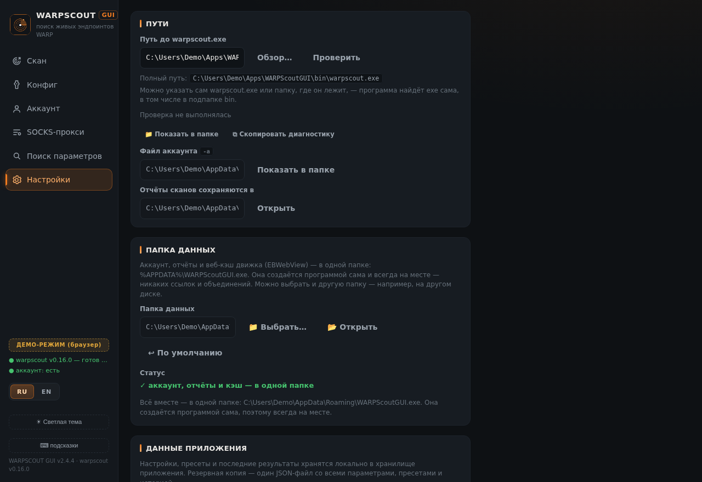
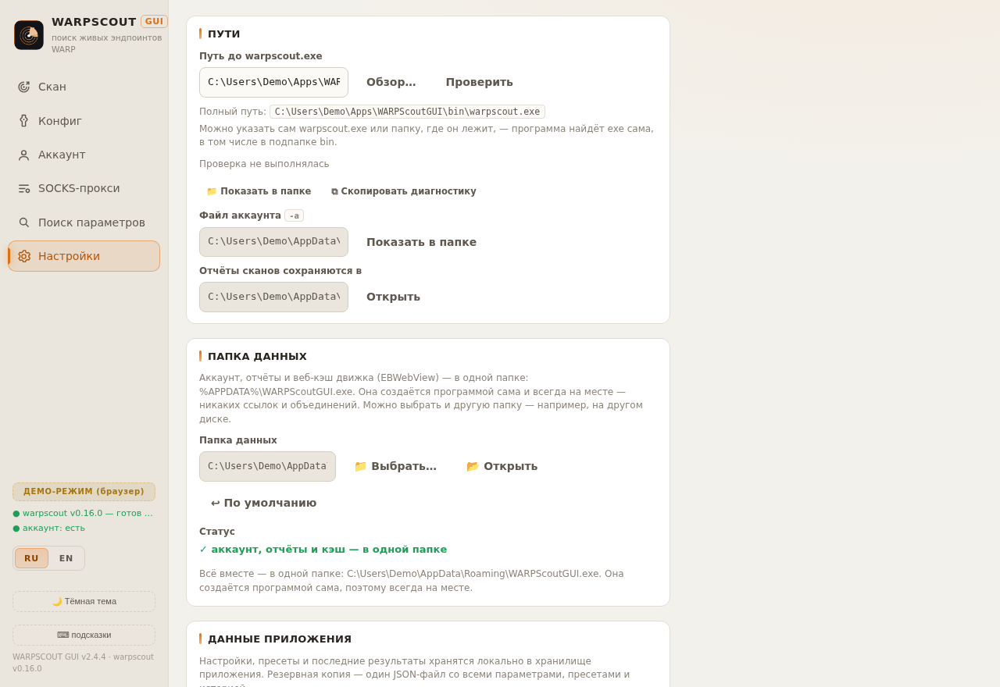

# WARPScoutGUI-AWG

Графическая оболочка для [**warpscout**](https://github.com/vernette/warpscout) — CLI-сканера WARP-эндпоинтов от [vernette](https://github.com/vernette) (Go, MIT). Суффикс **-AWG** отличает этот GUI от прочих обёрток: проект работает с конфигурациями в формате **AmneziaWG** (awg31).

Десктопное приложение (Neutralino.js) вокруг CLI-утилиты `warpscout.exe`: регистрация WARP-аккаунтов, генерация `.conf` в формате AmneziaWG, импорт/валидация конфигов, QR-коды, сканер статуса аккаунтов.

## Интерфейс

| Тёмная тема | Светлая тема |
|---|---|
|  |  |

▶ **Веб-демо интерфейса** (на моках, без Neutralino) — [**rvmxl.github.io/WarpScoutGUI-AWG**](https://rvmxl.github.io/WarpScoutGUI-AWG/) — можно пощёлкать интерфейс прямо в браузере, ничего не скачивая.

## Скачать

Готовые portable-сборки (Windows x64, без установки) — в разделе **[Releases](https://github.com/RVMXL/WarpScoutGUI-AWG/releases)**: `WARPScoutGUI-<версия>-win64.zip`. В архиве: `WARPScoutGUI.exe`, `resources.neu`, `bin/warpscout.exe`, `README.txt`, тексты лицензий (`LICENSE-AWG.txt` — Apache-2.0 для самой программы; `LICENSE-warpscout.txt`, `LICENSE-neutralino.txt`, `LICENSE-qrcode.txt` — MIT для сторонних компонентов; в релизах до v2.4.5 — только три MIT-текста).

Текущая версия: **v2.4.4**. История изменений — в описаниях релизов.

## Ключевые возможности

- Регистрация WARP-аккаунтов через `warpscout` с живым логом процесса и реальными кодами выхода
- Генерация конфига AmneziaWG (awg31): endpoint, порт, DNS-пресеты (Cloudflare / Quad9 / Google / AdGuard) с тумблером «Использовать IPv6» (вкл. по умолчанию), obfuscation-параметры (S1/S2, H1–H4, Jc/Jmin/Jmax)
- Предпросмотр команды запуска и итогового `.conf`
- Импорт существующих конфигов с распознаванием параметров (включая обе формы DNS-строки)
- QR-код конфига: одиночный (до 2953 байт) или **многостраничный** в формате AmneziaVPN (побайтово совместим с их импортером, порядок страниц не важен)
- Сканирование статуса аккаунтов с настраиваемым concurrency, сравнение A/B, экспорт CSV / HTML-отчёт
- Локальное состояние в localStorage, тёмная/светлая тема, RU/EN i18n

## Структура репозитория

| Путь | Назначение |
|---|---|
| `desktop-app/resources/` | Исходники GUI (`index.html`, `js/app.js`, `css/app.css`, иконки) |
| `desktop-app/neutralino.config.json` | Конфигурация Neutralino (версия, окно, CLI-аргументы) |
| `desktop-app/bin/` | Runtime-бинарники Neutralino (все платформы) |
| `desktop-app/pkg/WARPScoutGUI/` | Собранный пакет приложения (exe + resources.neu) |
| `docs/` | Скриншоты интерфейса |

## Сборка (Windows x64)

```bash
cd desktop-app
npx --yes @neutralinojs/neu@11 build --release
# → dist/WARPScoutGUI/{resources.neu, WARPScoutGUI-win_x64.exe}
# пакет собирается в pkg/WARPScoutGUI/ и упаковывается в zip
```

## Авторство и лицензии

**Сам WarpScoutGUI-AWG** (код GUI: `resources/`, конфигурация, упаковка) — © 2026 RVMXL, лицензия **[Apache License 2.0](LICENSE)** (текст — [`LICENSE`](LICENSE), атрибуция — [`NOTICE`](NOTICE); в архивах релизов — `LICENSE-AWG.txt`).

В состав распространяемых архивов входят сторонние компоненты; все они — под лицензией **MIT**, полные тексты прикладываются к каждому релизу:

| Компонент | Источник | Лицензия | Текст в архиве |
|---|---|---|---|
| **warpscout** (CLI, `bin/warpscout.exe`) | [vernette/warpscout](https://github.com/vernette/warpscout) (Go, © Nikita S.) | MIT | `LICENSE-warpscout.txt` |
| **Neutralino** — ядро (`WARPScoutGUI.exe`) и клиент (`neutralino.js` v6.10.0 внутри `resources.neu`) | [neutralinojs/neutralinojs](https://github.com/neutralinojs/neutralinojs) | MIT © Neutralinojs and contributors | `LICENSE-neutralino.txt` (включая лицензии встроенных в ядро C++-библиотек: asio, websocketpp, mbedTLS, nlohmann/json, webview и др.) |
| **QR Code Generator for JavaScript** (`resources/js/qrcode.js`) | [kazuhikoarase/qrcode-generator](https://github.com/kazuhikoarase/qrcode-generator) (© 2009 Kazuhiko Arase) | MIT | `LICENSE-qrcode.txt` |

- Протокол **AmneziaWG** внутри warpscout реализован на базе [amneziawg-go](https://github.com/amnezia-vpn/amneziawg-go) (MIT), который в свою очередь основан на [wireguard-go](https://github.com/WireGuard/wireguard-go) (© Jason A. Donenfeld, MIT).
- Слово «QR Code» — зарегистрированный товарный знак **DENSO WAVE INCORPORATED**.
- **Этот репозиторий — не форк**: это независимый проект (Neutralino.js GUI), написанный с нуля вокруг CLI-утилиты; общей истории коммитов с апстримом нет.
- Не аффилировано с Cloudflare, Amnezia и DENSO WAVE. WARP — товарный знак Cloudflare, Inc.
